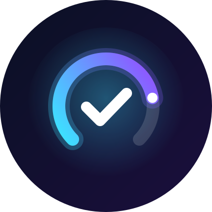

# ペアリングチェッカー / Pairing Checker

レコーダーの「外出先視聴」や、ライブTVサービスの「家でのチェックイン」の期限切れを防ぐ Android アプリです。
家のWi-Fiにいるときを見計らって、期限が近いアプリを更新します。

## ダウンロード
**[PairingChecker-latest.apk](https://github.com/ino-tools/pairing-checker/raw/main/PairingChecker-latest.apk)**（Android 8.0 以上）

前の版の上からそのまま入れれば、設定を残したまま更新されます。

## できること
- 期限をひと目で確認（残り日数をリングで表示）
- 家のWi-Fiにいるときにお知らせ。設定すれば自動で更新（充電中・使っていない間だけ）
- AI BOX モード（オットキャストなど）：家で電源を入れるだけで、つながった瞬間に更新
- 対応：どこでもディーガ、Video & TV SideView、スマホdeレグザ、AQUOSリモートプレーヤー2、DiXiM Play、YouTube TV、Hulu + Live TV、Fubo、ほか任意のアプリ

## 改善要望
アプリの「設定 → 改善要望を送る」から送れます。届いた要望は毎日確認し、対応できるものはアプリに反映します。

## プライバシー
[PRIVACY.md](PRIVACY.md)

---

# Pairing Checker (English)

Keeps remote-viewing pairings (Japanese recorders) and home check-ins (YouTube TV, Hulu + Live TV, Fubo) from expiring.
It waits until you are on your home Wi-Fi, then reminds you or renews automatically.

**[Download PairingChecker-latest.apk](https://github.com/ino-tools/pairing-checker/raw/main/PairingChecker-latest.apk)** (Android 8.0+)

This app is for people who travel and want to keep their own subscriptions working. It does not bypass any service's sharing rules.
Send feedback from Settings → Send feedback.
